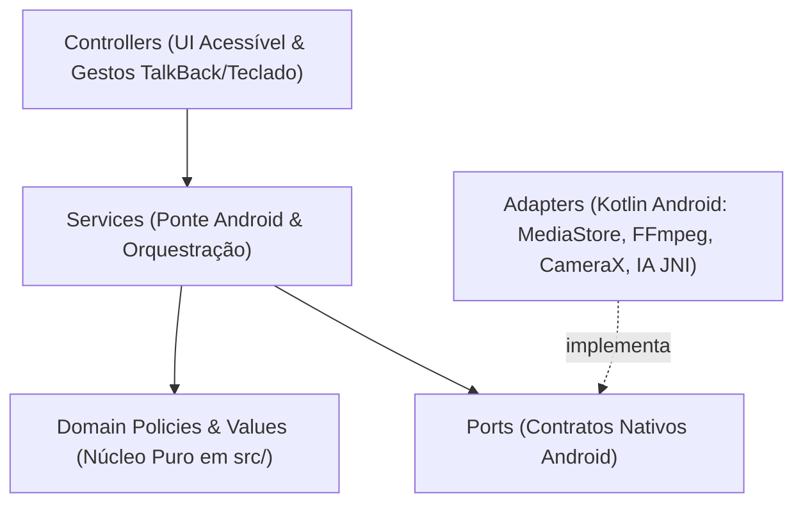

# Arquitetura do Sistema — Olho da Cena Android

## 1. Visão Geral e Fluxo de Dependências

### Descrição Textual da Arquitetura (Acessível para Leitor de Tela / NVDA e TalkBack)
1. **Camada de Entrada (`controllers` em `ui/` e `MainActivity.kt`):** Recebe comandos do usuário por gestos de toque do TalkBack (deslize e dois toques), barras de ação móveis ou atalhos de teclado físico Bluetooth/USB, e delega para um único comando de `service`.
2. **Camada de Aplicação (`services` em `src/android-ponte-service.js` e `OlhoBridgeService.kt`):** Orquestra a comunicação entre a interface web e o sistema Android, coordenando armazenamento duplo, foco de áudio, renderização em segundo plano e compartilhamento.
3. **Núcleo de Domínio (`policies` e `values` em `src/`):** Contém todas as regras matemáticas, acústicas, de enquadramento, respiração, legendas, diagnóstico visual, fotos, posts e geração de argumentos FFmpeg, 100% livres de I/O direto.
4. **Fronteira de Infraestrutura (`ports` e `adapters`):** `src/android-nativo-port.js` define o contrato abstrato; `src/android-nativo-adapter.js` e os adaptadores Kotlin implementam o acesso real ao `MediaStore`, `WebViewAssetLoader`, câmera, microfone e motores de IA.

## 2. Decisões Arquiteturais Congeladas (`**Decided**`)
- **Decided:** Preservar 100% dos módulos de domínio puro em `src/` e telas acessíveis em `ui/`, adicionando suporte de toque TalkBack sem remover nenhum atalho de teclado físico.
- **Decided:** Armazenamento duplo em `Documentos/Olho da Cena` (`Universal` e `Avançado`) com indexação automática no `MediaStore` (Galeria do Android) e botão nativo `"Compartilhar"`.
- **Decided:** Pausar gravações automaticamente em caso de chamada telefônica, alarme ou perda de foco de áudio, protegendo os pedaços já gravados em disco.

## 3. Onde vive (Mapa Canônico de Módulos)

| Subsistema / Preocupação | Caminho no Repositório | Papel (`Role`) | Invariante Principal |
| :--- | :--- | :--- | :--- |
| Política de Armazenamento Android | `src/android-armazenamento-policy.js` | `policy` | Resolve pastas `Universal`/`Avançado`, indexação na Galeria e lixeira |
| Política de Interrupção Mobile | `src/android-interrupcao-policy.js` | `policy` | Decide pausa segura e anúncio falado em chamadas/alarmes |
| Contrato Nativo Android | `src/android-nativo-port.js` | `port` | Isola o núcleo das APIs nativas do sistema Android |
| Adaptador Nativo Android JS | `src/android-nativo-adapter.js` | `adapter` | Conecta `window.OlhoAndroidNativo` ou adaptador de teste em memória |
| Serviço da Ponte Android | `src/android-ponte-service.js` | `service` | Expõe `window.api` unificada para todas as telas da interface |
| Controlador de Toque Mobile | `ui/toque-controles-controller.js` | `controller` | Ativa barras de toque TalkBack, botão Voltar e reação a chamadas |
| Atividade Principal Android | `android/app/src/main/java/br/com/olhodacena/MainActivity.kt` | `controller` | Hospeda o WebView acessível, WakeLock e Intents de compartilhamento |
| Adaptador de Assets Android | `android/app/src/main/java/br/com/olhodacena/OlhoAssetLoaderAdapter.kt` | `adapter` | Serve `app://olho/` e assets locais com suporte a Range HTTP |
| Serviço de Ponte Kotlin | `android/app/src/main/java/br/com/olhodacena/OlhoBridgeService.kt` | `service` | Implementa `@JavascriptInterface`, `MediaStore`, Clipboard e AudioFocus |
| Manifesto Android | `android/app/src/main/AndroidManifest.xml` | `adapter` | Declara permissões, serviço de segundo plano e `Share Target` |
| Abertura e Boas-Vindas | `src/abertura.js` | `policy` | Regras de tela inicial e configuração inicial |
| Ajuste de Volume, Velocidade e Tom | `src/ajuste.js` | `policy` | Filtros FFmpeg de volume, velocidade, graves e agudos |
| Atalhos de Edição de Áudio | `src/atalhos-audio.js` | `policy` | Mapeamento puro de teclas e saltos de edição |
| Verificação de Atualização OTA | `src/atualizacao.js` | `policy` | Comparação de versões, SHA-256 e `baseRuntime` |
| Catálogo de Trilhas de Áudio | `src/audios.js` | `policy` | Regras de trilhas de fundo em loop ou estáticas |
| Cadeia de Filtros de Áudio | `src/cadeia.js` | `policy` | Composição de filtros de áudio FFmpeg |
| Conversão de Formatos | `src/conversao.js` | `policy` | Regras puras de extensão e conversão de mídia |
| Cortes e Marcadores de Edição | `src/cortar.js` | `policy` | Intervalos marcados, inversão e validação de cortes |
| Descritor de Imagens e Câmera | `src/descritor.js` | `policy` | Prompts e formatação de descrições do modelo visual |
| Diagnóstico Visual em 3 Janelas | `src/diagnostico.js` | `policy` | Agregação de enquadramento, luz e fundo nas 3 janelas |
| Dividir Vídeo em Partes | `src/dividir.js` | `policy` | Cálculo de partes por tempo ou cortes manuais |
| Divisão de Texto em Telas | `src/divisao.js` | `policy` | Quebra de frases para leitura e títulos |
| Enquadramento e Posição | `src/enquadramento.js` | `policy` | Geometria facial, distância, espelho e alertas falados |
| Construtor de Comandos FFmpeg | `src/ffmpeg-builder.js` | `policy` | Montagem pura de grafos de filtro para Montar Vídeo |
| Resolução de Binários FFmpeg | `src/ffmpeg-path.js` | `adapter` | Localização de executáveis FFmpeg/FFprobe |
| Formatos e Proporções de Tela | `src/formatos.js` | `value` | Dimensões 9:16, 16:9, 1:1, 4:5 e 1:1.6 |
| Triagem e Recorte de Fotos | `src/fotos-editar.js` | `policy` | Regras de diagnóstico em lote e nomes de saída |
| Processamento Fotográfico | `src/fotos.js` | `service` | Análise fotográfica, molduras, figurinhas e fundo |
| Frases de Feedback Falado | `src/frases.js` | `value` | Textos padronizados para leitor de tela |
| Juntar Vídeos e Nivelamento | `src/juntar.js` | `policy` | Conferência de vídeos, títulos por parte e mediana de áudio |
| Posicionamento de Legenda | `src/legenda.js` | `policy` | Geometria básica de legenda |
| Estilos e Quebra de Legendas | `src/legendas.js` | `policy` | Estilos por rede social, karaokê e ajuste de SRT |
| Logos em Título ou Faixa | `src/logos.js` | `policy` | Dimensionamento por área e faixa de topo |
| Conversor em Lote Áudio-Vídeo | `src/lote.js` | `policy` | Detecção de áudios, logo e fundo em pasta |
| Marcas de Tempo | `src/marcas.js` | `policy` | Manipulação de marcas de tempo ordenadas |
| Melhorar Vídeo e Fundos | `src/melhorar.js` | `policy` | Catálogo de 19 fundos, contraste com roupa e máscara |
| Conversão Estéreo/Mono | `src/mono.js` | `policy` | Detecção de canal único e filtro pan mono |
| Objetos na Cena | `src/objetos.js` | `policy` | Tradução e posição de objetos detectados pelo MediaPipe |
| Padrão de Nomes e Pastas | `src/padrao.js` | `policy` | Sanitização de nomes de arquivos |
| Pastas de Posts | `src/pastas-posts.js` | `policy` | Estrutura de saída para posts |
| Pastas de Saída Universal/Avançado | `src/pastas-saida.js` | `policy` | Mapeamento de pastas `Universal` vs `Avançado` |
| Atmosferas e Presets Visuais | `src/presets.js` | `value` | Os 10 presets visuais e curvas de zoompan |
| Cálculo de Progresso | `src/progresso.js` | `policy` | Percentual e estimativa de tempo |
| Geometria de Recorte | `src/recorte.js` | `policy` | Cálculo de caixa de recorte centrada no rosto |
| Orquestrador de Renderização | `src/render.js` | `service` | Execução de pipelines de renderização de vídeo |
| Detecção de Respirações e Silêncios | `src/respiracoes.js` | `policy` | Análise de silêncios e respirações para corte automático |
| Filtragem de Seleção | `src/selecao.js` | `policy` | Busca e filtragem de opções em árvore |
| Execução Segura de Subprocessos | `src/spawn-seguro.js` | `adapter` | Wrapper de execução sem shell |
| Parser e Gerador SRT/ASS | `src/srt.js` | `policy` | Conversão entre tempos, SRT e ASS |
| Formatação de Tempo Falado | `src/tempo.js` | `policy` | Conversão de segundos para fala em português |
| Textos e Ajuda do Estúdio | `src/textos.js` | `value` | Dicionário de mensagens da interface |
| Linha do Tempo de Imagens | `src/timeline.js` | `policy` | Distribuição de durações de imagens no Montar Vídeo |
| Títulos Visuais no Vídeo | `src/titulos.js` | `policy` | Filtros drawtext e posicionamento de títulos |
| Extração de Trechos | `src/trecho.js` | `policy` | Cálculo de início e duração de trechos |
| Sugestão e Corte de Posts em Vídeo | `src/video-post.js` | `policy` | Sugestão de trechos fortes para Reels/TikTok/Shorts |
| Editor de Áudio e Cortes UI | `ui/audio-cortes.js` | `controller` | Interface de edição de vídeo/áudio, cortes e trilhas |
| Tela Editar Fotos UI | `ui/foto-editar.js` | `controller` | Interface de triagem e edição de até 200 fotos |
| Tela Tirar Foto UI | `ui/foto.js` | `controller` | Interface de câmera fotográfica guiada por voz |
| Tela Gravar Áudio UI | `ui/gaudio.js` | `controller` | Interface de gravação de áudio em 2 etapas |
| Tela Gravar Vídeo e Melhorar UI | `ui/gravar.js` | `controller` | Interface de gravação de vídeo, leitura na sombra e melhorar |
| Documento HTML Principal | `ui/index.html` | `adapter` | Estrutura DOM semântica com regiões ARIA live |
| Tela de Legendas UI | `ui/legenda-tela.js` | `controller` | Fluxo de 4 passos de legendas e revisão de falas |
| Pós-processamento de Máscara UI | `ui/mascara.js` | `policy` | Suavização de máscara de segmentação |
| Menu em Árvore Acessível UI | `ui/menu.js` | `controller` | Árvore inicial navegável por setas e por toque TalkBack |
| Player Simples de Pré-escuta UI | `ui/player.js` | `controller` | Player rápido antes de decidir salvar ou descartar |
| Tela de Posts em Vídeo UI | `ui/post-video.js` | `controller` | Interface de criação de posts em vídeo |
| Tela de Posts em Imagem UI | `ui/post.js` | `controller` | Interface de criação de posts em imagem/carrossel |
| Controlador Geral de Telas UI | `ui/renderer.js` | `controller` | Navegação entre telas, Montar Vídeo, Dividir, Juntar e Lote |
| Componente de Árvore de Seleção UI | `ui/selecao.js` | `controller` | Árvore de escolha de fundos, molduras e figurinhas |
| Folha de Estilos Acessível | `ui/style.css` | `adapter` | Estilos de alto contraste e botões de toque grandes |
| Worker de Visão MediaPipe | `ui/visao-worker.js` | `adapter` | Web Worker de inferência MediaPipe |
| Bundle MediaPipe Tasks Vision | `ui/vision_bundle.cjs` | `adapter` | Biblioteca empacotada do MediaPipe |
| Verificador Único do Repositório | `tools/dev.py` | `controller` | Instrumento de voo único (`doctor`, `build`, `check`) |
